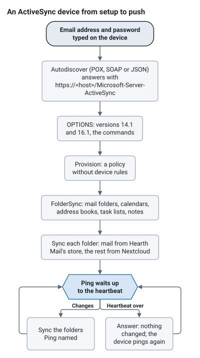
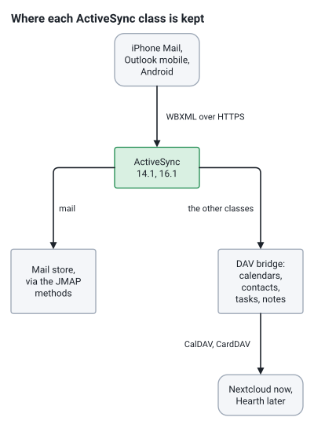

# Exchange ActiveSync and Autodiscover

Status: built (steps 1 to 6; see "Steps" for what is proven), approved by the maintainer on 2026-11-23 ("Exchange ActiveSync 14.1
and 16.1: mail, calendars, contacts, tasks and notes, with push through
Ping, meeting responses, search and out of office. Autodiscover in its
POX, SOAP and JSON dialects, so clients configure themselves from an email
address and a password."). Built in the steps at the end; docs/progress.md
says which are done.

## What people get

- On an iPhone (Mail, Calendar, Contacts, Reminders, Notes), in Outlook
  for iOS and Android, and in Android's Exchange clients (Gmail, Samsung
  Email, Nine): add an Exchange account with the email address and the
  password (or an app password). The device finds the server by itself
  and gets mail, calendars, contacts, tasks and notes in one account, with
  push.
- Protocol versions 14.1 and 16.1 (MS-ASHTTP). A device picks the highest
  it knows; both are served by the same code, with the 16.x differences
  (calendar `Instance`/`ClientUid` handling, `Find`, drafts sync) noted
  where they apply.
- Mail lives in Hearth Mail. Calendars, contacts, tasks and notes live in
  Nextcloud now (Hearth later) and are reached through a bridge over
  CalDAV and CardDAV, so the same events and cards appear in Nextcloud's
  web pages, in Tidings and in any DAV client.
- An iPhone or Mac can instead be set up in one tap: after signing in on
  Hearth Mail's setup page, a `.mobileconfig` profile installs the mail
  account (IMAP and SMTP) and CalDAV and CardDAV accounts for the cloud.

## How it is built

Two new crates, so the protocol can be tested without a server:

- `crates/activesync-proto`: no server code. The WBXML codec (MS-ASWBXML),
  its code pages generated from the specification's tables
  (`tools/activesync/codepages.py`, the source and its version named in
  the generated file), the request line (the plain and the base64 query of
  MS-ASHTTP 2.2.1.1.1), and the conversions between ActiveSync items and
  iCalendar and vCard (MS-ASCAL, MS-ASCNTC, MS-ASTASK, MS-ASNOTE) through
  the calcard crate, which comes back from the fork base (vendor/calcard,
  0.3.14, as inbuxa had it).
- `crates/activesync`: the server side. One HTTP route,
  `/Microsoft-Server-ActiveSync`, answered by the HTTP listener that
  already serves JMAP; sign-in is the listener's (Basic with the password
  or an app password, or a bearer token).

### Mail: the JMAP methods, in process

Every mail command is carried out by building a JMAP request and handing
it to the same `handle_jmap_request` the `/jmap` endpoint uses, with the
device's access token: `Mailbox/get` and `Mailbox/changes` for
FolderSync, `Email/query`, `Email/changes` and `Email/get` for Sync,
`Email/set` for flags, moves and deletes, `Email/import` and
`EmailSubmission/set` for sending, `VacationResponse` for out of office,
`Principal/query` for the address book search. Why: one implementation
of permissions, quotas, ACLs on shared mailboxes, undelete, legal holds
and push for every protocol, and nothing for ActiveSync to keep in step.
One ActiveSync command is one in-process JMAP request (several method
calls with back-references), so there is no extra round trip; the cost is
building and reading the JSON, measured in step 4.

A folder's first sync (and GetItemEstimate before it) lists the folder
with `Email/query`, filtered and sorted by receipt date. With PostgreSQL
or MySQL as the search store (as when it is the data store) the message
cache answers that, current the moment a message is stored. With another
search store (RocksDB, FoundationDB, SQLite, an external search engine) it
goes through the search index, which a background task fills shortly
after delivery: a message that arrives in that moment can be left out of
the device's first listing, and the device gets it only after a resync.
Run ActiveSync with PostgreSQL or MySQL as the search store; the tests on
RocksDB wait for the index after each delivery.

### Calendars, contacts, tasks, notes: the DAV bridge

- Settings (environment, as the contacts lookup): `INBUXA_DAV_URL`, the
  cloud's DAV root (`https://cloud.example.org/remote.php/dav` for
  Nextcloud), and `INBUXA_DAV_AUTH`, how Hearth Mail signs in there:
  - `passthrough`: with the credentials the device signed in with. For a
    cloud that accepts the same passwords (Hearth, a Nextcloud on the same
    directory). A device signed in with a token gets mail only.
  - `app-password`: with an app password the person links once on the
    setup page, through Nextcloud's Login Flow v2 (the person approves
    Hearth Mail in Nextcloud; Nextcloud hands over an app password that
    the person can revoke there at any time). Kept in the store, per
    account.
  Without `INBUXA_DAV_URL` the bridge is off and devices get mail only.
- Discovery: `current-user-principal`, then `calendar-home-set` and
  `addressbook-home-set` (RFC 4791, 6352). Each calendar becomes a
  calendar folder when it holds VEVENT, a task folder when it holds VTODO
  (a Nextcloud calendar holding both is both), a notes folder when it
  holds VJOURNAL; each address book a contacts folder. Notes are VJOURNAL
  entries (RFC 5545), the standard form Hearth's CalDAV keeps too. When no
  calendar holds VTODO or VJOURNAL, a "Tasks" or "Notes" calendar is made
  (MKCALENDAR) the first time a device asks for folders: Nextcloud 35's
  own calendars hold events only. Read-only collections (the birthday
  calendar) are left out.
- Changes: `sync-collection` (RFC 6578) with the token kept per device and
  folder; Nextcloud and Hearth both support it. Writes are `PUT` with
  `If-Match` (no lost updates), deletes are `DELETE` with `If-Match`.
- Conversion: MS-ASCAL <-> VEVENT (recurrences, exceptions, attendees,
  reminders, time zones as the ActiveSync `TimeZone` blob), MS-ASCNTC <->
  vCard 3/4, MS-ASTASK <-> VTODO, MS-ASNOTE <-> VJOURNAL. What has no
  counterpart is kept: the original iCalendar or vCard is read before a
  change is written, and only the properties ActiveSync carries are
  replaced, so a field set in Nextcloud survives an edit on the phone.
- Hearth later: the bridge speaks plain CalDAV and CardDAV behind one
  trait (`DavSource`), so moving to Hearth is a change of `INBUXA_DAV_URL`
  (and `passthrough`, as Hearth shares the sign-in).

### Device state

Per account, device and folder: the sync key, the folder's state at that
key (the JMAP state for mail, the DAV sync token for the rest), and which
items the device has (ActiveSync needs to know what to delete). Kept in
the in-memory key-value store under its own prefix (`KV_ACTIVESYNC`), not
in a new store layout: nothing changes for the data inbuxa reads, so the
rollback in docs/cutover.md stays as it is. Each entry expires after 60
days without use; a device whose state expired is told to sync again from
the start (status 3 or 9, as the specification provides). The previous
key's state is kept until the device uses the new one, so a device that
lost a response repeats the request and gets the same answer.

### Push

Ping (MS-ASCMD 2.2.1.13) waits on the server's push manager for mail, the
same events JMAP's EventSource receives, so a delivery answers a waiting
Ping at once. Folders in the cloud have no push to Hearth Mail: while a
Ping waits, their sync tokens are compared every 60 seconds (one PROPFIND
per folder, a few hundred bytes). Heartbeats from 60 to 3540 seconds are
accepted (the specification's limits; Exchange allows up to 59 minutes).

### Commands

| Command | What it does here |
|---|---|
| OPTIONS | versions 14.1, 16.1 and the commands below |
| Provision | a policy with no device rules (no PIN, no encryption demanded); keys are issued but not enforced (no 449), and remote wipe is not offered |
| FolderSync, FolderCreate, FolderUpdate, FolderDelete | mailboxes; DAV calendars, address books and journals |
| Sync | the five classes; Add, Change, Delete, Fetch; windowing, filter types (time windows for mail and calendars, incomplete tasks), MIME and body preferences (AirSyncBase), conflicts resolved with the server winning |
| GetItemEstimate | counts from the same change logic |
| ItemOperations | Fetch of a message, a body or an attachment; EmptyFolderContents |
| MoveItems | `Email/set` mailboxIds |
| SendMail, SmartReply, SmartForward | `Email/import` into Sent and `EmailSubmission/set`; SmartReply and SmartForward add the original (quoted, or as attachments when the device sends no `ReplaceMime`) |
| MeetingResponse | from an invitation in the mail or an event in a calendar: the event is written to the calendar with the attendee's answer (PARTSTAT), and the iTIP REPLY (RFC 5546) is sent to the organizer; the invitation's mail is moved to Deleted Items, as Exchange does |
| Search | Mailbox (JMAP text search in a folder or everywhere) and GAL (the people in the directory the account can see) |
| Settings | Oof (JMAP VacationResponse, with the message and the dates), DeviceInformation (kept with the device), UserInformation (the account's addresses) |
| Ping | above |
| ResolveRecipients | the GAL search, for addresses typed in a message |
| Find (16.1) | the Search command's mail part |
| ValidateCert | not offered: devices check certificates themselves |

### Autodiscover

Alongside the Thunderbird autoconfig that is there now:

- POX: `POST /autodiscover/autodiscover.xml` already answers the Outlook
  schema; the ActiveSync schema
  (`.../autodiscover/mobilesync/responseschema/2006`, MS-ASCMD 2.2.1.1)
  is added, answering with `https://<host>/Microsoft-Server-ActiveSync`.
- SOAP: `POST /autodiscover/autodiscover.svc`, `GetUserSettings` and
  `GetDomainSettings` (MS-OXWSADISC): the display name, the address, and
  the IMAP, POP3 and SMTP connection settings; settings Hearth Mail
  doesn't have (EWS, ECP, OAB) are answered with `SettingIsNotAvailable`.
  MS-OXWSADISC has no ActiveSync setting, so ActiveSync clients that use
  SOAP fall back to POX, as with Exchange.
- JSON: `/autodiscover/autodiscover.json/v1.0/<address>?Protocol=ActiveSync`
  (and `AutodiscoverV1`, as now), which Outlook mobile asks first.
- All three answer anonymously, from the address alone, under the
  anonymous rate limit. The ActiveSync answers and the SOAP settings are
  given only for domains this server serves (others get the dialect's
  error: mobilesync status 2, SOAP `InvalidUser`/`InvalidDomain`, JSON
  `MailboxNotFound`); the Outlook POX answer is unchanged. The SOAP
  connection settings follow the legacy-protocol policy, as POX does.

### The Apple profile

`/setup` (Hearth Mail's own small page, no console needed): the person
signs in with address and password; the page offers "Download for iPhone
and Mac" and, with `INBUXA_DAV_AUTH=app-password`, "Connect Nextcloud".
The profile holds a `com.apple.mail.managed` payload (IMAP on 993, SMTP on
465, the address as user name) and `com.apple.caldav.account` and
`com.apple.carddav.account` payloads for `INBUXA_DAV_URL` with the cloud
user name; no password is put in it (the device asks once). It is served
as `application/x-apple-aspen-config` and is unsigned at first (iOS shows
it as "Unverified"); signing it with the server's certificate is a
follow-up.

## Tests

- Unit tests in both crates: WBXML round trips and the specification's
  own byte examples (MS-ASWBXML 3.1), the query forms (MS-ASHTTP 4.x),
  every converter both ways with the specification's examples (MS-ASCAL,
  MS-ASCNTC, MS-ASTASK, MS-ASNOTE section 4), sync-state bookkeeping.
- Replays: recorded sessions of iPhone Mail, Outlook mobile and an Android
  Exchange client (`tests/resources/activesync/<client>/`), each a list of
  requests (headers, query and the body as XML) and the answers expected.
  They are built from the specification's examples (MS-ASCMD section 4,
  MS-ASAIRS, MS-ASHTTP) and the documented behaviour of each client
  (headers, user agents, the order of commands at setup); each file names
  its source. They are not captures from real devices: none were
  available.
- Integration: the replays run against a test server (the `tests` crate)
  with a stand-in DAV server for the bridge, and against a throwaway
  instance with a throwaway Nextcloud, end to end.
- Unproven until the maintainer tries them: real iPhones, Outlook mobile and
  Android devices. docs/progress.md lists each as unproven until then.

## Running the tests

    ci/cargo.sh test -p activesync-proto -p activesync -p dav-client
    STORE=RocksDb ci/cargo.sh test -p tests activesync -- --test-threads=1
    tools/activesync/test-dav-nextcloud.sh      # the DAV client, throwaway Nextcloud
    tools/activesync/test-bridge-nextcloud.sh   # the replays with the bridge on

## Steps

1. This plan.
2. `activesync-proto`: WBXML, code pages, the request line.
3. Autodiscover: the ActiveSync POX schema, SOAP, the JSON protocol.
4. `activesync`: OPTIONS, Provision, FolderSync, Sync for mail,
   GetItemEstimate, ItemOperations, MoveItems, SendMail, SmartReply,
   SmartForward, Search, Settings, Ping.
5. The DAV bridge: discovery, the four classes, MeetingResponse.
6. `/setup` and the Apple profile; Login Flow v2.
7. Replays, the throwaway proof, the README.
